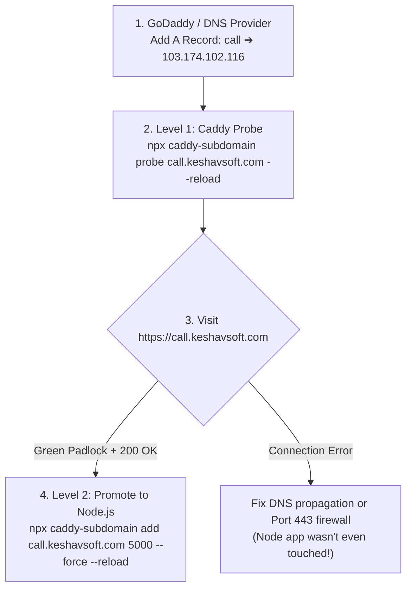

# caddy-subdomain

[](https://www.npmjs.com/package/caddy-subdomain)
[](https://opensource.org/licenses/ISC)
[](https://keshavsoft.github.io/caddy-subdomain/)
[](https://github.com/keshavsoft/caddy-subdomain)
[](https://caddyserver.com/docs/)

> **The Single-Purpose Subdomain Engine for Caddy JSON.**  
> Safely test DNS & automatic HTTPS with zero-dependency smoke probes, then promote to reverse proxies with automatic backups and zero downtime.

---

## 📑 Table of Contents

- [The Subdomain Lifecycle](#-the-subdomain-lifecycle)
  - [Level 1: The Smoke Test Probe (Zero Dependencies)](#level-1-the-smoke-test-probe-zero-dependencies)
  - [Level 2: Promote to Backend Reverse Proxy](#level-2-promote-to-backend-reverse-proxy)
- [Interactive Documentation Portal](#-interactive-documentation-portal)
- [Quick Start with `npx`](#-quick-start-with-npx)
- [CLI Command Reference](#-cli-command-reference)
  - [`caddy-subdomain probe`](#1-caddy-subdomain-probe-domain)
  - [`caddy-subdomain add`](#2-caddy-subdomain-add-domain-port)
  - [`caddy-subdomain list`](#3-caddy-subdomain-list-configpath)
  - [`caddy-subdomain check`](#4-caddy-subdomain-check-domain)
- [Programmatic ESM Library Reference](#-programmatic-esm-library-reference)
- [Safety & Auto-Backups](#-safety--auto-backups)
- [Troubleshooting & FAQ](#-troubleshooting--faq)

---

## 🧭 The Subdomain Lifecycle

When creating a new subdomain (e.g. on GoDaddy, Cloudflare, or Namecheap), trying to configure your Node.js application, ports, Caddy reverse proxy, and SSL certificate all at the same time is prone to frustrating connection errors.

`caddy-subdomain` introduces a **two-stage verification workflow**:



---

### Level 1: The Smoke Test Probe (Zero Dependencies)
Before starting Node.js or allocating ports, verify that **DNS points to your server** and that **Caddy's Automatic HTTPS issued an SSL certificate**:

```bash
npx caddy-subdomain probe call.keshavsoft.com /etc/caddy/caddy.json --reload
```

**How it works under the hood:**
- Injects a native Caddy `static_response` handler (HTTP 200 OK).
- Requires **zero open ports, zero files on disk, and zero backend processes**.
- Caddy automatically contacts Let's Encrypt / ZeroSSL to generate your TLS certificate.
- Open `https://call.keshavsoft.com` in your browser. When you see the **Green Padlock** and confirmation message, your network pipe and SSL are 100% verified.

---

### Level 2: Promote to Backend Reverse Proxy
Now that the domain and SSL certificate are proven live, promote the subdomain to your actual application:

```bash
npx caddy-subdomain add call.keshavsoft.com 5000 /etc/caddy/caddy.json --force --reload
```

- Replaces the probe with a clean `reverse_proxy` pointing to `localhost:5000`.
- Retains existing TLS certificates—zero re-negotiation downtime!

---

## 🌐 Interactive Documentation Portal

Explore live examples, visual flowcharts, and the interactive command builder:  
👉 **[https://keshavsoft.github.io/caddy-subdomain/](https://keshavsoft.github.io/caddy-subdomain/)**

---

## 🚀 Quick Start with `npx`

Zero installation required. Run directly in any environment with Node.js installed:

```bash
# 1. Probe a new domain (Level 1 Flight Check)
npx caddy-subdomain probe call.keshavsoft.com --reload

# 2. Add or promote to a Node / Python / Go backend port
npx caddy-subdomain add call.keshavsoft.com 5000 --force --reload

# 3. List all configured subdomains
npx caddy-subdomain list

# 4. Check if a domain already exists in Caddy
npx caddy-subdomain check call.keshavsoft.com
```

---

## ⚙️ CLI Command Reference

### Default Config Resolution
If no file path is specified, `caddy-subdomain` automatically checks:
1. `./caddy.json` in current directory.
2. `/etc/caddy/caddy.json` (standard Linux/VPS path).

---

### 1. `caddy-subdomain probe <domain>`
Injects a Level-1 test probe route returning a `200 OK` text response.

```bash
npx caddy-subdomain probe <domain> [configPath] [options]
```

**Options:**
- `--reload`: Immediately triggers `caddy reload --config <file>`.
- `--force`: Overwrites any existing route for this domain.
- `--no-backup`: Skips creating a `.bak.<timestamp>` file.

**Example:**
```bash
npx caddy-subdomain probe billing.keshavsoft.com /etc/caddy/caddy.json --reload
```

---

### 2. `caddy-subdomain add <domain> <port>`
Appends or updates a reverse proxy route forwarding traffic to your backend target.

```bash
npx caddy-subdomain add <domain> <port> [configPath] [options]
```

**Options:**
- `--reload`: Hot-reloads Caddy server immediately after writing.
- `--force`: Replaces an existing domain entry (useful when promoting a probe).
- `--no-backup`: Disables automatic backup creation.

**Example:**
```bash
npx caddy-subdomain add billing.keshavsoft.com 5000 /etc/caddy/caddy.json --force --reload
```

---

### 3. `caddy-subdomain list [configPath]`
Prints an indexed list of every unique subdomain registered across all HTTP servers in your Caddy configuration.

```bash
npx caddy-subdomain list /etc/caddy/caddy.json
```

**Sample Output:**
```text
Configured Subdomains in /etc/caddy/caddy.json (5):

  1. quotation.keshavsoft.com
  2. washtex5.keshavsoft.com
  3. cli.keshavsoft.com
  4. cc9.keshavsoft.com
  5. call.keshavsoft.com
```

---

### 4. `caddy-subdomain check <domain> [configPath]`
Validates whether a domain is already registered before modifying configurations.

```bash
npx caddy-subdomain check quotation.keshavsoft.com
```

**Sample Output:**
```text
❌ Domain 'quotation.keshavsoft.com' is ALREADY configured in /etc/caddy/caddy.json
```

---

## 📦 Programmatic ESM Library Reference

Use `caddy-subdomain` directly in your Node.js scripts and microservices:

```javascript
import {
  readCaddyConfig,
  writeCaddyConfig,
  listSubdomains,
  hasSubdomain,
  buildProbeRoute,
  addProbeSubdomainToFile,
  buildProxyRoute,
  addSubdomainToFile
} from "caddy-subdomain";
```

### Methods

#### `readCaddyConfig(filePath)`
Safely loads and parses Caddy JSON.
```javascript
const config = readCaddyConfig("./caddy.json");
```

#### `listSubdomains(config)`
Returns an array of unique domain strings: `string[]`.
```javascript
const domains = listSubdomains(config);
// ['api.keshavsoft.com', 'call.keshavsoft.com']
```

#### `hasSubdomain(config, domain)`
Returns boolean `true` if domain exists (case-insensitive).
```javascript
if (hasSubdomain(config, "call.keshavsoft.com")) {
  console.log("Domain taken!");
}
```

#### `addProbeSubdomainToFile(filePath, options)`
Adds Level-1 probe route to file with backup.
```javascript
const result = addProbeSubdomainToFile("/etc/caddy/caddy.json", {
  domain: "call.keshavsoft.com",
  backup: true
});
console.log(result.backupFile); // /etc/caddy/caddy.json.bak.1795123000
```

#### `addSubdomainToFile(filePath, options)`
Adds Level-2 reverse proxy route to file with backup.
```javascript
const result = addSubdomainToFile("/etc/caddy/caddy.json", {
  domain: "call.keshavsoft.com",
  port: 5000,
  force: true,  // Replaces the Level-1 probe
  backup: true
});
```

---

## 🛡️ Safety & Auto-Backups

Whenever a write operation occurs (`add` or `probe`), `caddy-subdomain` writes a timestamped snapshot before touching the live file:

```text
/etc/caddy/
├── caddy.json                     # Active live config
├── caddy.json.bak.1795132001      # Backup created before probe
└── caddy.json.bak.1795132500      # Backup created before promote
```

If an issue ever occurs, restoring is as simple as:
```bash
cp /etc/caddy/caddy.json.bak.<timestamp> /etc/caddy/caddy.json
caddy reload --config /etc/caddy/caddy.json
```

---

## ❓ Troubleshooting & FAQ

### 1. Probe route returns connection refused in browser
- **Cause**: DNS hasn't propagated yet or VPS firewall is blocking port 80 / 443.
- **Verification**: Run `nslookup call.keshavsoft.com` on your local PC. Ensure the IP matches your VPS. Ensure ports 80 and 443 are open (`ufw allow 80 && ufw allow 443`).

### 2. Can Caddy issue SSL certificates for private IP addresses?
- **Answer**: No, Let's Encrypt and ZeroSSL require a public DNS A/AAAA record pointing to a public IP address (such as your GoDaddy DNS record).

### 3. How do I switch a probe to my Node.js application?
- Run `add` with `--force`:
  ```bash
  npx caddy-subdomain add <domain> <port> --force --reload
  ```
  `--force` seamlessly replaces the static probe route with the reverse proxy.

---

## 🔗 The KeshavSoft Caddy Suite

- **[caddy-subdomain](https://github.com/keshavsoft/caddy-subdomain)**: Subdomain management, smoke probes, and collision detection.
- **[caddy-template](https://github.com/keshavsoft/caddy-template)**: Battle-tested Caddy JSON route blueprints.
- **[caddy-cli](https://github.com/keshavsoft/caddy-cli)**: High-level orchestrator and port inspector.

---

## 📄 License

[ISC](LICENSE) &copy; [KeshavSoft](https://github.com/keshavsoft)
