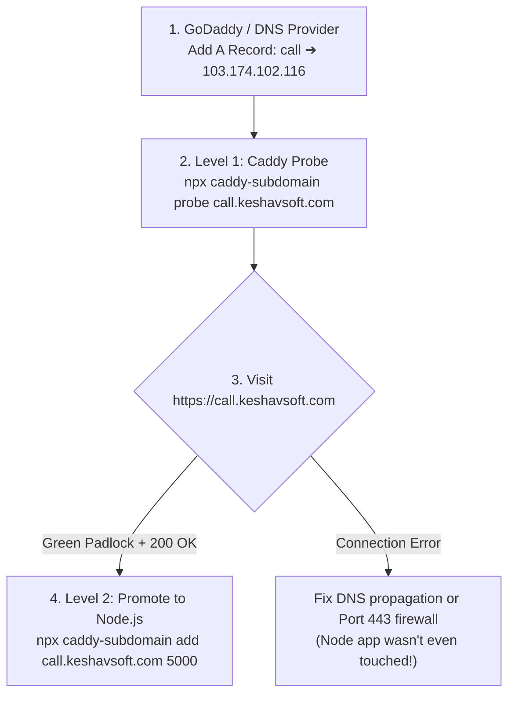

# caddy-subdomain

[](https://www.npmjs.com/package/caddy-subdomain)
[](https://opensource.org/licenses/ISC)
[](https://keshavsoft.github.io/caddy-subdomain/)
[](https://github.com/keshavsoft/caddy-subdomain)
[](https://caddyserver.com/docs/)

> **The Single-Purpose Subdomain Engine for Caddy JSON.**  
> Safely test DNS & automatic HTTPS with zero-dependency smoke probes, then promote to reverse proxies with automatic backups and zero downtime.

---

## 📑 Table of Contents

- [The Subdomain Lifecycle](#-the-subdomain-lifecycle)
  - [Level 1: The Smoke Test Probe (Zero Dependencies)](#level-1-the-smoke-test-probe-zero-dependencies)
  - [Level 2: Promote to Backend Reverse Proxy](#level-2-promote-to-backend-reverse-proxy)
- [Interactive Documentation Portal](#-interactive-documentation-portal)
- [Quick Start with `npx`](#-quick-start-with-npx)
- [CLI Command Reference](#-cli-command-reference)
  - [`caddy-subdomain probe`](#1-caddy-subdomain-probe-domain)
  - [`caddy-subdomain add`](#2-caddy-subdomain-add-domain-port)
  - [`caddy-subdomain list`](#3-caddy-subdomain-list-configpath)
  - [`caddy-subdomain check`](#4-caddy-subdomain-check-domain)
- [Programmatic ESM Library Reference](#-programmatic-esm-library-reference)
- [Safety & Auto-Backups](#-safety--auto-backups)
- [Troubleshooting & FAQ](#-troubleshooting--faq)

---

## 🧭 The Subdomain Lifecycle

When creating a new subdomain (e.g. on GoDaddy, Cloudflare, or Namecheap), trying to configure your Node.js application, ports, Caddy reverse proxy, and SSL certificate all at the same time is prone to frustrating connection errors.

`caddy-subdomain` introduces a **two-stage verification workflow**:



---

### Level 1: The Smoke Test Probe (Zero Dependencies)
Before starting Node.js or allocating ports, verify that **DNS points to your server** and that **Caddy's Automatic HTTPS issued an SSL certificate**:

```bash
npx caddy-subdomain probe call.keshavsoft.com
```

**How it works under the hood:**
- **Zero Config Passing:** Automatically discovers `/etc/caddy/caddy.json` on your VPS or `./caddy.json` locally.
- **Automatic Reload:** Executes hot-reload automatically without needing flags.
- **Zero Port/Process Overhead:** Injects a native Caddy `static_response` handler (HTTP 200 OK).
- **Direct Terminal Feedback:**
  ```text
  Subdomain:        call.keshavsoft.com
  Present in Caddy: Yes (Probe Active)
  Caddy Reload:     Success
  Live HTTPS:       Yes (200 OK - Verified)
  ```

---

### Level 2: Promote to Backend or Static File Server
Now that the domain and SSL certificate are proven live, promote the subdomain to your actual architecture:

#### Option A: Reverse Proxy (Node.js / Express / Docker / Go)
```bash
npx caddy-subdomain add call.keshavsoft.com 5000
```
- Replaces the probe with a clean `reverse_proxy` pointing to `localhost:5000`.
- Automatically executes hot-reload in memory.
- Retains existing TLS certificates—zero re-negotiation downtime!

#### Option B: Static File Server (HTML / React / Vue SPAs / Docs)
```bash
npx caddy-subdomain static call.keshavsoft.com /usr/share/caddy/call.keshavsoft.com
```
- Configures Caddy's native `file_server` with `vars` root (matches `cli.keshavsoft.com` VPS setup).
- Powered by `caddy-template` static engine with zero Node.js server overhead.

---

## 🌐 Interactive Documentation Portal

Explore live examples, visual flowcharts, and the interactive command builder:  
👉 **[https://keshavsoft.github.io/caddy-subdomain/](https://keshavsoft.github.io/caddy-subdomain/)**  
👉 Dedicated NPX Command Catalog: **[https://keshavsoft.github.io/caddy-subdomain/npx/](https://keshavsoft.github.io/caddy-subdomain/npx/)**

---

## 🚀 Quick Start with `npx`

Zero installation and zero path configuration required:

```bash
# 1. Probe a new domain (Level 1 Flight Check: auto-detects config & auto-reloads)
npx caddy-subdomain probe call.keshavsoft.com

# 2. Add or promote to a Node / Python / Go backend port
npx caddy-subdomain add call.keshavsoft.com 5000

# 3. Check if a domain already exists in Caddy (Instant Yes / No answer)
npx caddy-subdomain check call.keshavsoft.com

# 4. List all configured subdomains
npx caddy-subdomain list
```

---

## ⚙️ CLI Command Reference

### Default Config Resolution
`caddy-subdomain` automatically checks in priority order:
1. `/etc/caddy/caddy.json` (standard Linux/VPS path).
2. `./caddy.json` in current directory.
3. Sibling/parent configuration files.

---

### 1. `caddy-subdomain probe <domain>`
Injects a Level-1 test probe route, auto-reloads Caddy, and probes live HTTPS:

```bash
npx caddy-subdomain probe call.keshavsoft.com
```

**Terminal Output:**
```text
Subdomain:        call.keshavsoft.com
Present in Caddy: Yes (Probe Active)
Caddy Reload:     Success
Live HTTPS:       Yes (200 OK - Verified)
```

---

### 2. `caddy-subdomain add <domain> <port|path>`
Appends or updates a reverse proxy route or auto-detected static path:

```bash
npx caddy-subdomain add call.keshavsoft.com 5000
```

**Terminal Output:**
```text
Subdomain:        call.keshavsoft.com
Target:           localhost:5000
Entry Type:       Level-2 Reverse Proxy
Caddy Reload:     Success
Status:           Active
```

---

### 3. `caddy-subdomain static <domain> [rootPath]`
Configures a high-performance static file server route using Caddy's native `file_server`:

```bash
npx caddy-subdomain static call.keshavsoft.com /usr/share/caddy/call.keshavsoft.com
```

**Terminal Output:**
```text
Subdomain:        call.keshavsoft.com
Document Root:    /usr/share/caddy/call.keshavsoft.com
Entry Type:       Level-2 Static File Server (file_server)
Caddy Reload:     Success
Status:           Active
```

---

### 4. `caddy-subdomain check <domain>`
Direct presence check. Returns a clean binary **Yes** or **No**:

```bash
npx caddy-subdomain check call.keshavsoft.com
```

**Terminal Output:**
```text
Subdomain:        call.keshavsoft.com
Present in Caddy: Yes
```

---

### 5. `caddy-subdomain list`
Prints an indexed list of every unique subdomain registered in Caddy with its target:

```bash
npx caddy-subdomain list
```

**Terminal Output:**
```text
Config: /etc/caddy/caddy.json
Subdomains (3):
  1. quotation.keshavsoft.com    ➔  localhost:8080       [reverse_proxy]
  2. cli.keshavsoft.com          ➔  /usr/share/caddy     [static]
  3. call.keshavsoft.com         ➔  static_response      [probe]
```

---

## 📦 Programmatic ESM Library Reference

Use `caddy-subdomain` directly in your Node.js scripts and microservices:

```javascript
import {
  readCaddyConfig,
  writeCaddyConfig,
  listSubdomains,
  hasSubdomain,
  buildProbeRoute,
  addProbeSubdomainToFile,
  buildProxyRoute,
  addSubdomainToFile,
  buildStaticRoute,
  addStaticSubdomainToFile
} from "caddy-subdomain";
```

### Methods

#### `readCaddyConfig(filePath)`
Safely loads and parses Caddy JSON.
```javascript
const config = readCaddyConfig("./caddy.json");
```

#### `listSubdomains(config)`
Returns an array of unique domain strings: `string[]`.
```javascript
const domains = listSubdomains(config);
// ['api.keshavsoft.com', 'call.keshavsoft.com']
```

#### `hasSubdomain(config, domain)`
Returns boolean `true` if domain exists (case-insensitive).
```javascript
if (hasSubdomain(config, "call.keshavsoft.com")) {
  console.log("Domain taken!");
}
```

#### `addProbeSubdomainToFile(filePath, options)`
Adds Level-1 probe route to file with backup.
```javascript
const result = addProbeSubdomainToFile("/etc/caddy/caddy.json", {
  domain: "call.keshavsoft.com",
  backup: true
});
console.log(result.backupFile); // /etc/caddy/caddy.json.bak.1795123000
```

#### `addSubdomainToFile(filePath, options)`
Adds Level-2 reverse proxy route to file with backup.
```javascript
const result = addSubdomainToFile("/etc/caddy/caddy.json", {
  domain: "call.keshavsoft.com",
  port: 5000,
  force: true,  // Replaces the Level-1 probe
  backup: true
});
```

---

## 🛡️ Safety & Auto-Backups

Whenever a write operation occurs (`add` or `probe`), `caddy-subdomain` writes a timestamped snapshot before touching the live file:

```text
/etc/caddy/
├── caddy.json                     # Active live config
├── caddy.json.bak.1795132001      # Backup created before probe
└── caddy.json.bak.1795132500      # Backup created before promote
```

If an issue ever occurs, restoring is as simple as:
```bash
cp /etc/caddy/caddy.json.bak.<timestamp> /etc/caddy/caddy.json
caddy reload --config /etc/caddy/caddy.json
```

---

## ❓ Troubleshooting & FAQ

### 1. Probe route returns connection refused in browser
- **Cause**: DNS hasn't propagated yet or VPS firewall is blocking port 80 / 443.
- **Verification**: Run `nslookup call.keshavsoft.com` on your local PC. Ensure the IP matches your VPS. Ensure ports 80 and 443 are open (`ufw allow 80 && ufw allow 443`).

### 2. Can Caddy issue SSL certificates for private IP addresses?
- **Answer**: No, Let's Encrypt and ZeroSSL require a public DNS A/AAAA record pointing to a public IP address (such as your GoDaddy DNS record).

### 3. How do I switch a probe to my Node.js application?
- Run `add` with `--force`:
  ```bash
  npx caddy-subdomain add <domain> <port> --force --reload
  ```
  `--force` seamlessly replaces the static probe route with the reverse proxy.

---

## ⚡ The Story: Why We Transitioned to Native JSON

According to the [official Caddy architecture documentation](https://caddyserver.com/docs/getting-started#the-caddyfile-is-an-adapter), **the Caddyfile is only an adapter**.

| Paradigm | [Caddyfile Adapter](https://caddyserver.com/docs/caddyfile) | [Native Caddy JSON](https://caddyserver.com/docs/json/) |
| :--- | :--- | :--- |
| **Primary Use** | Manual text editing | True source of truth |
| **API Support** | Static, requires file reload | Full zero-downtime [Caddy Admin API](https://caddyserver.com/docs/api) (`:2019`) |
| **Fleet Automation** | Fragile regex string parsing (`sed`) | Safe, programmatic JSON AST manipulation |
| **Active WebSockets** | Risk of dropped sockets via systemctl | Preserved in-memory across hot reloads |

**Why `caddy-subdomain` exists:** Configuring DNS, SSL, ports, and Node.js all at once makes debugging connection errors impossible. By decoupling verification into Level 1 (in-memory smoke probe via `static_response: 200 OK`) and Level 2 (promotion to reverse proxy), `caddy-subdomain` guarantees that DNS and TLS work before any backend code runs.

---

## 🧩 The KeshavSoft Caddy Suite Ecosystem

| Repository | Responsibility | npm / Docs | Key Command |
| :--- | :--- | :--- | :--- |
| **[`caddy-cli`](https://github.com/keshavsoft/caddy-cli)** | Observability & Port Mapping | [](https://www.npmjs.com/package/caddy-cli) | `npx caddy-cli -p` |
| **[`caddy-template`](https://github.com/keshavsoft/caddy-template)** | Route Blueprint Generation | [](https://www.npmjs.com/package/caddy-template) | `npx caddy-template proxy <host> <port>` |
| **[`caddy-subdomain`](https://github.com/keshavsoft/caddy-subdomain)** | Smoke Probes & Promotion | [](https://www.npmjs.com/package/caddy-subdomain) | `npx caddy-subdomain probe <host>` |
| **[`caddy-fileserver`](https://github.com/keshavsoft/caddy-fileserver)** | Ubuntu Filesystem Bridge | [](https://www.npmjs.com/package/caddy-fileserver) | `npx caddy-fileserver init <host>` |
| **[`caddy-knowledge`](https://github.com/keshavsoft/caddy-knowledge)** | Master Architectural Handbook | [Live Handbook](https://keshavsoft.github.io/caddy-knowledge/) | Full Suite Reference |
| **[`caddy-template-knowledge`](https://github.com/keshavsoft/caddy-template-knowledge)** | Route Blueprint Manual | [Live Manual](https://keshavsoft.github.io/caddy-template-knowledge/) | AST Deep-Dives |
| **[`caddy-hosting`](https://github.com/keshavsoft/caddy-hosting)** | Unified Gateway & Hub | [Live Portal](https://keshavsoft.github.io/caddy-hosting/) | Gateway Hub |

---

## 📄 License

[ISC](LICENSE) &copy; [KeshavSoft](https://github.com/keshavsoft)
